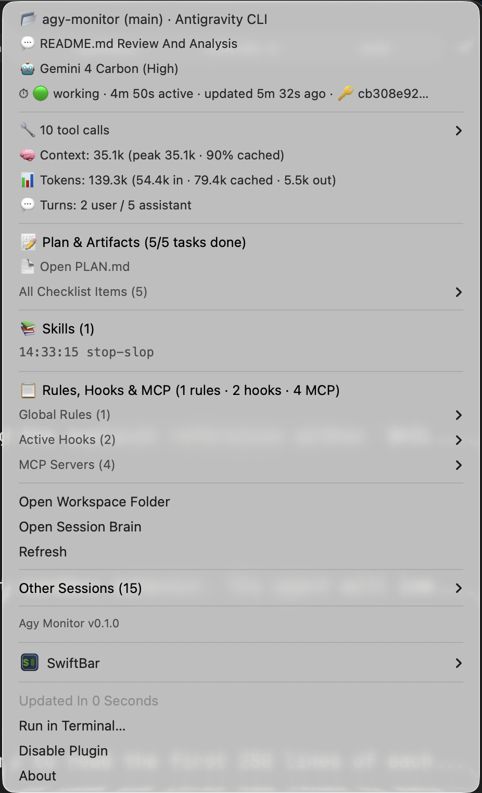

# Antigravity Monitor


`agy-monitor` is a macOS menu bar plugin for [SwiftBar](https://github.com/swiftbar/SwiftBar) and [xbar](https://xbarapp.com) that tracks live Antigravity (`agy`) and Jetski (`jetski`) sessions. You can watch desktop IDE windows, CLI terminals, headless runs, subagents, and swarms from one dropdown, following the design of [`eggboy/copilotcli-monitor`](https://github.com/eggboy/copilotcli-monitor).

## What It Shows



- **Primary session header**: repository or CitC client, Git branch (including worktrees), surface badge (`Jetski CLI`, `Jetski IDE`, `Antigravity App`, `Antigravity Hub`, `Antigravity CLI`), title or prompt summary, model, active duration, and short session ID.
- **Three-state liveness**: separates running sessions (`working`), idle windows waiting on input (`open`), and exited sessions (`closed`) by intersecting open `.lock` file descriptors from `lsof` with descendant run state.
- **Live context window and compactions**: current context fill (`input_tokens + cache_read_tokens` on the latest planner turn), peak fill, prompt-cache hit rate, and `CHECKPOINT` compaction count.
- **Token breakdown and child rollups**: cumulative input, cache-read, and output tokens for the root conversation, plus rolled-up tokens and tool calls from child subagents and swarm workers.
- **Tool calls and failure separation**: per-tool call counts that split command or tool errors from macOS Seatbelt sandbox blocks (`BypassSandbox` retries).
- **API and quota alerts**: `ERROR_MESSAGE` events (`RESOURCE_EXHAUSTED`, rate limits) with a menu bar warning badge if the latest step failed.
- **Plan and artifacts**: clickable links to Markdown artifacts in `brain/<id>/` and GFM task progress (`- [ ]`, `- [/]`, `- [x]`) from session plans, `PLAN.md`, and `task.md`.
- **Native swarms and subagents**: worker names, roles, models, phases (`RUNNING`, `WAITING`, `KILLED`), board sequence numbers, `[stall]` or `[done]` tags, unread lag, and subagent runs. Click a worker or subagent to pin it.
- **Skills, inbox, tasks, and customizations**: invoked skills, unread agent messages, background task logs, repo and global rule files (`AGENTS.md`, `GEMINI.md`, `CLAUDE.md`, `.agents/rules`), hooks, and enabled, working MCP servers.
- **Other sessions**: up to 15 root sessions ordered by `working`, `open`, and `closed` state, keeping child worker UUIDs tucked under their coordinator. Click a session to pin it, or reset to auto-selection.

The plugin displays the Antigravity monochrome tray icon while a session is `working` or `open`, switching to a warning badge on an unresolved API or quota error. Once sessions close, the menu bar shows a yellow dot for 5 minutes after the last turn and a grey dot after that.

## Prerequisites

- **macOS** (SwiftBar and xbar run on macOS).
- **Node.js >= 22.18** (Node 24+ or 26+ recommended for built-in TypeScript stripping and `node:sqlite`), **[Bun](https://bun.sh)**, or `tsx`, with zero runtime `npm` dependencies.
- **ShellCheck** (for development, run by `npm run lint`).

## Installation

### 1. Install SwiftBar

```bash
brew install --cask swiftbar
```

Launch SwiftBar from `/Applications` and pick a plugin directory (for example `~/Library/Application Support/SwiftBar/Plugins`).

### 2. Install Node.js

Skip this step if you have Node.js >= 22.18, Bun, or `tsx`.

```bash
brew install node
```

### 3. Install the plugin

```bash
git clone https://github.com/eggboy/agy-monitor.git
cd agy-monitor/scripts
./install-menubar.sh
```

The installer finds SwiftBar or xbar, symlinks `agy-monitor.5s.sh` into the plugins folder, clears stale helper symlinks, and marks the scripts executable. Expect the icon in your menu bar within 5 seconds.

### Manual Installation

Symlink `agy-monitor.5s.sh` into your SwiftBar plugins directory. The wrapper locates `agy-menubar.ts` in the source checkout through `readlink`:

```bash
PLUGINS_DIR="$(defaults read com.ameba.SwiftBar PluginDirectory)"
ln -s "$(pwd)/scripts/agy-monitor.5s.sh" "${PLUGINS_DIR}/agy-monitor.5s.sh"
chmod +x scripts/agy-monitor.5s.sh scripts/agy-menubar.ts
```

## Uninstallation

```bash
cd agy-monitor/scripts
./uninstall-menubar.sh
```

The uninstaller deletes the plugin symlink from SwiftBar or xbar and leaves your checkout and `~/.gemini/` files intact.

## How It Works

```text
SwiftBar (5s timer)
  └── agy-monitor.5s.sh    (bash wrapper: sets PATH, probes node/bun/tsx)
        └── agy-menubar.ts (TypeScript: queries SQLite + lsof + transcript cache)
```

1. **SwiftBar** invokes `agy-monitor.5s.sh` on a 5-second timer set by the `.5s.` filename segment.
2. **Runtime probing**: the wrapper picks `node` (>= 22.18 with `--no-warnings`, caching the version check against the `node` binary mtime) before falling back to `bun`, `tsx`, or `npx --yes tsx`.
3. **Multi-root discovery**: `agy-menubar.ts` scans `~/.gemini/jetski`, `~/.gemini/antigravity`, and `~/.gemini/antigravity-cli` (or `AGY_MONITOR_DIRS`), opens `conversation_summaries.db` in read-only mode (`node:sqlite` or `bun:sqlite`), and inspects `PRAGMA table_info` to project available columns.
4. **Open-FD liveness verification**: `<root>/presence/<id>.lock` files stay on disk as 0-byte markers after exit. One non-blocking `lsof -b` call (500 ms cap with a 15-second TTL fallback in `presence.json`) maps open `.lock` descriptors to live `jetski-cli`, `language_server`, and `agy` PIDs.
5. **Incremental transcript caching**: `agy-menubar.ts` reads `transcript.jsonl` from `lastOffset` in 1 MiB `Buffer` chunks split on `0x0a` (`\n`), then caches derived stats in `~/.gemini/.agy-monitor-cache/` by `(inode, size, mtimeMs)`. It also matches model names from `conversations/<id>.db` (`gen_metadata`) against an allow-list and caches them by `(conversationId, stepCount)`.
6. **Output sanitization**: SwiftBar splits each line on its first literal `|`. `emit()` formats all output lines, substituting `│` (`U+2502`) for `|` in labels, stripping Unicode control characters, and removing quotes and backslashes from `bash=` parameters.

## Configuration

Rename the symlinked wrapper to adjust the refresh rate:

| Filename | Refresh Interval |
| :--- | :--- |
| `agy-monitor.5s.sh` | 5 seconds (default) |
| `agy-monitor.10s.sh` | 10 seconds |
| `agy-monitor.30s.sh` | 30 seconds |

Set these environment variables for tests or custom paths:

- `AGY_MONITOR_DIRS`: colon-separated `<appDataDir>` roots to scan instead of `~/.gemini/{jetski,antigravity,antigravity-cli}`.
- `AGY_MONITOR_STATE_DIR`: directory for `.agy-monitor-cache/` and `.agy-monitor-primary` (defaults to `~/.gemini`).
- `AGY_MONITOR_CONFIG_DIR`: path for global rules, `hooks.json`, and `mcp_config.json` (defaults to `~/.gemini/config`).

## Limitations

- **macOS**: SwiftBar and xbar require macOS.
- **Read-only**: the plugin opens SQLite databases in read-only mode and leaves `~/.gemini/{jetski,antigravity,antigravity-cli}` untouched. Cache and pin state live in `~/.gemini/.agy-monitor-cache/` and `~/.gemini/.agy-monitor-primary`.

## Development

Install dev dependencies and run the checks:

```bash
npm install
npm run lint
npm run typecheck
npm test
```

The test suite in `test/agy-menubar.test.ts` builds isolated SQLite and JSONL fixtures in temporary directories without touching `~/.gemini/`.
